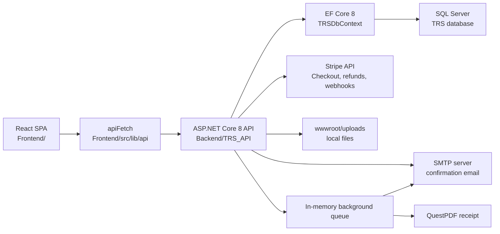
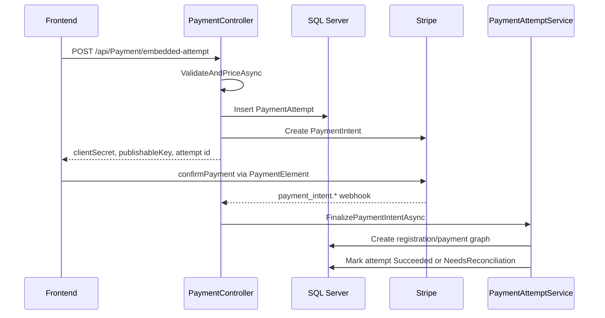

# TRS_ARCHITECTURE.md

This document describes the current technical architecture. Code is the source of truth.

## Payment gateway extraction (2026-10-07)

Embedded payment attempt creation, checkout retrieval, payment lookup, and cancellation now use `IPaymentGateway`, implemented by `StripePaymentGateway` under `Backend/TRS_API/Services/Payments/`. The adapter owns Stripe SDK requests, provider-error translation, and normalization into `GatewayPayment`. `PaymentAttemptService` retains validation, persistence, idempotency-key generation, expiry rules, and recovery decisions. The Stripe SDK services are injected for testing; production retains the existing Stripe client/configuration behavior.

The Stripe webhook controller still verifies the original request signature before normalizing embedded-payment events. Shared embedded finalization and attempt state updates now receive provider-neutral data rather than Stripe `PaymentIntent` objects. Internal `GatewayPaymentState` enum values distinguish payment-method entry, confirmation, authentication, capture, processing, success, cancellation, and unknown states. They are not new database statuses or API values. Unknown provider states remain unresolved by recovery rather than being treated as failure. Existing short persisted statuses and state transitions are retained.

This is still an incremental extraction. Stripe remains the only configured gateway; credentials, compatibility identifiers, diagnostic messages, and schema references remain Stripe-oriented until the separately approved data/configuration phase. Public API fields and status polling are unchanged. Legacy hosted checkout creation/confirmation retains its existing implementation. Normal refund submission and unmatched-payment reconciliation lookups/refunds now call the adapter. Controllers retain validation, database transactions, duplicate protection, pending-refund persistence, audit logs, cancellation outcomes, and API responses. `GatewayRefund` returns existing TRS P/S/F codes; `GatewayRefundPayment` carries the original payment reference, decimal amount, and any existing lookup validation error. Stripe refund webhook processing remains unchanged. Reconciliation payloads retain the original serialized Stripe object, so existing consumers do not receive the new internal DTO unexpectedly. Successful recovery still does not fabricate an incoming webhook-log entry.

The next configuration foundation is described below; Fiuu integration is not included. Existing two-decimal money conversions are preserved inside the adapter; broader currency handling is a separate change. Adapter tests cover card/PayNow request parameters, metadata, idempotency, normalized amounts/states, lookup, cancellation, refund parameters/status mapping, embedded and hosted reconciliation lookup, and error propagation. They do not replace database integration or real Stripe sandbox verification of the new phase.

## High-Level Architecture

## Frontend Architecture

### Stack

- React 18
- TypeScript
- Vite
- React Router v6
- Tailwind CSS
- Radix/shadcn-style UI components
- Lucide icons
- Quill/react-quill packages
- TanStack Query is installed, but most code uses direct imperative API calls.

### Routing

Routes live in `Frontend/src/App.tsx`.

`AdminLayout` wraps all `/admin/*` pages, checks authentication, and handles the `mustChangePassword` redirect.

### State

The frontend uses component state and React contexts:

- `AuthContext`: token lifecycle, current user, login/logout.
- `ThemeContext`: theme values.
- `LiveConfigContext`: loads public system config from `GET /api/config`.

Registration cart state lives mainly in `EventDetail.tsx`. The current paid flow uses embedded Stripe Elements in `EmbeddedPaymentModal`; cart/contact context is kept in browser storage only so refreshes or failed attempts can preserve user input.

### API Pattern

All API modules call `apiFetch` from `Frontend/src/lib/api/_base.ts`.

`apiFetch`:

- Uses native `fetch`.
- Applies configured `API_BASE`.
- Clears local auth state and redirects to `/login` on 401.
- Returns raw `Response` to wrapper modules.

Wrapper modules return `ApiResult<T>` where practical.

## Backend Architecture

### Stack

- ASP.NET Core 8
- EF Core 8
- SQL Server
- Stripe.NET
- QuestPDF
- BCrypt.Net
- HtmlSanitizer
- Serilog

### Middleware Pipeline

Current order in `Program.cs`:

1. Swagger/SwaggerUI in development.
2. HTTPS redirection outside development.
3. Security headers middleware.
4. CORS policy `AllowFrontend`.
5. Rate limiter.
6. Authentication.
7. Authorization.
8. Static files.
9. Controllers.

Security headers include CSP, `X-Content-Type-Options`, `X-Frame-Options`, and `X-XSS-Protection`.

Public payment rate limiting uses opaque browser-session partitions for general/create requests and the secret payment-attempt key for submit/status/abandon requests. It does not rely on client IP or forwarded proxy headers.

### Controller Pattern

Controllers use attribute routing. Most admin mutations use `[Authorize(Roles = "superadmin,eventadmin")]`; user management and orphan refunds are superadmin-only.

Business logic is mixed:

- Shared registration validation/persistence is centralized in `RegistrationWorkflowService`.
- Embedded Stripe PaymentIntent attempt creation/finalization is centralized in `PaymentAttemptService`.
- Legacy hosted Checkout finalization is centralized in `PaymentFinalizationService`.
- Fixture logic is centralized in `FixtureGenerationService`.
- Status-code constants for API logic are centralized in `StatusCodesEx`.
- Admin action audit snapshots are centralized in `AdminAuditService` where implemented.
- Several controllers still directly query and mutate `TRSDbContext`.

### Service Pattern

Services are registered in DI in `Program.cs`.

- Scoped: auth, registration, embedded payment attempts, legacy payment finalization, fixtures, email, receipt.
- Singleton: background job queue.
- Hosted: background job worker and payment cleanup worker.

Stripe SDK service objects are created inline where needed instead of being injected behind an interface.

## Database Architecture

`TRSDbContext` in `Backend/TRS_Data/Models/TRSDbContext.cs` owns the EF model.

### Main Entity Groups

Configuration/auth/logging:

- `SystemConfig`
- `AdminUser`
- `AppLog`
- `AdminAuditLog`
- `AdminAuditLogDetail`
- `PaymentAuditLog`

Events and programs:

- `Event`
- `EventGalleryImage`
- `EventDocument`
- `EventRestrictedSbaPlayer`
- `TrsProgram` mapped to `Programs`
- `ProgramField`
- `ProgramCustomField`
- `BadmintonClub` mapped to `BadmintonClub`

Database and API status values are short codes. Events store `RegistrationStatus` as `O`, `PA`, or `CL`. Runtime registration availability is computed by the backend from stored status, Singapore date, event activity, and active program count, producing `D`, `U`, `O`, `PA`, or `CL`. Frontend UI converts codes to human-readable labels for display.

Registration:

- `EventRegistration`
- `ParticipantGroup`
- `Participant`
- `ParticipantCustomFieldValue`
- `EventParticipant` legacy model

Payment:

- `Payment`
- `PaymentItem`
- `Refund`
- `PaymentAttempt`
- `PendingCheckout`
- `WebhookLog`

Competition:

- `Fixture`
- `SbaRanking`

Jobs:

- `BackgroundJob` exists in EF, but current runtime uses the in-memory `BackgroundJobQueue`.

### Important Constraints and Indexes

- One payment per registration: `UQ_Payments_Registration`.
- Unique Stripe session/payment identifiers when present.
- One fixture per event/program: `UQ_Fixtures_EventProgram`.
- Unique admin email: `UQ_AdminUsers_Email`.
- Filtered unique orphan refund index on `Refunds.GatewaySessionId`.
- SBA ranking filtered unique indexes for singles and doubles.
- Unique event/SBA member restriction: `UQ_EventRestrictedSbaPlayers_Event_SbaID`.

Event SBA restrictions are stored independently from `SbaRankings`, which is replaced during ranking imports. Public validation and payment-attempt creation read the event restriction table, while event updates and registration/payment persistence coordinate through an event-row update lock to prevent a restriction/payment race. Only admin endpoints return the restricted player list.

### Denormalized Fields

The system intentionally stores snapshots:

- `EventRegistration.EventName`
- `ParticipantGroup.ProgramName`
- `ParticipantGroup.ClubDisplay`
- `ParticipantGroup.NamesDisplay`
- `PaymentItem.ProgramName`
- `PaymentItem.Description`
- `PaymentItem.PlayerName`
- `Payment.EventId`

These avoid expensive joins and preserve historical labels after event/program edits.

## Payment Architecture

### Embedded Payment Attempt Flow

The webhook is the source of truth for final registration creation. The browser polls attempt status and only clears the cart after the backend reports a finalized registration. Late success after attempt expiry and finalization failures are marked for reconciliation rather than auto-registering.

Registration event gating is explicit in `RegistrationWorkflowService`:

- `StrictPublic` for public direct registration and new payment attempts.
- `AdminAssisted` for logged-in admins registering from the event detail page.
- `AlreadyPaidFinalization` for payment finalization after money has already moved.

This keeps admin-assisted pre-payment registration separate from already-paid finalization bypasses.

### Legacy Hosted Checkout Flow

`PaymentController` still supports `create-checkout-session` and `confirm-session` for older hosted Checkout return URLs. That path stores payloads in `PendingCheckouts` and finalizes through `PaymentFinalizationService`.

## Background Work

Receipt generation and payment confirmation email are queued through `IBackgroundJobQueue`.

Implementation notes:

- Queue is in-memory (`Channel<Func<CancellationToken, Task>>`).
- Jobs are lost if the process restarts.
- Payment confirmation jobs generate receipt and registration-details PDFs.
- Cancellation/refund notification jobs are queued after database state is saved and batch actions send one email for the batch.
- Email failures are logged but do not retry.
- `PaymentCleanupWorker` deletes expired legacy pending checkout rows and sweeps embedded attempts for expiry/backstop reconciliation.

## Logging Architecture

Serilog is configured through `builder.Host.UseSerilog`.

Configured sinks:

- Console.
- `EFCoreSink`, writing to `AppLogs`.

`EFCoreSink` creates a scoped `TRSDbContext` per log event, writes the event, and swallows sink exceptions.

Admin audit logging is separate from application logging. `AdminAuditService` stores action-level old/new JSON snapshots in `AdminAuditLog` and flattened changed fields in `AdminAuditLogDetail`. It is used by implemented admin mutation paths such as event/program changes, fixture mutations, badminton club CRUD, and SBA import-created clubs.

## File Storage

Uploads are local disk files below API web root:

`Backend/TRS_API/wwwroot/uploads/...`

The API returns relative paths and serves them with static file middleware. There is no storage abstraction for cloud storage.

## Fixture Architecture

Fixtures are stored as rows in `Fixtures` with `BracketStateJson`.

Supported formats in current code:

- `knockout`
- `group_knockout`
- `round_robin`
- `heats`

The backend owns generation and mutation; the frontend wizard sends config and seed entries.

Generating a fixture closes the affected program to stop further registrations. Registration validation also blocks programs that already have a fixture row.

## Architectural Risks

- Public registration and receipt lookup use sequential ids.
- Uploads are unauthenticated at the controller level.
- In-memory background jobs are not durable.
- Stripe SDK is not abstracted.
- Local disk uploads are not horizontally scalable without shared storage.
- `EventParticipant` and `BackgroundJob` remain as legacy/unused EF surfaces.
- Dual registration status fields on registrations increase consistency risk.
- Event registration availability is partly stored and partly computed; frontend screens should use backend `computedRegistrationStatus` and treat frontend date logic only as fallback.
- SQL scripts exist but there are no EF migration files in the repository.
- Short-code status consistency depends on keeping backend constants, SQL constraints/scripts, and frontend label maps in sync.

## Gateway configuration foundation (2026-10-08)

`PaymentGatewayConfigurationService` manages the non-secret active code in SystemConfig and reads the PaymentGateways catalog. `PaymentGatewayConfigController` exposes superadmin-only GET/PUT endpoints; the existing ConfigController rejects direct writes to the reserved gateway key. The Master Config Payment section loads catalog availability, requires explicit save, and sends the last reviewed version. Serializable locking, expected-version checking, and AdminAuditService keep selection changes and their audit atomic.

`PaymentGatewayResolver` maps recorded provider codes to registered adapters case-insensitively. New attempts snapshot the active provider; EF disallows later provider edits. Existing attempt operations, online refunds, and orphan refunds resolve their original provider independently of catalog availability for new payments. Explicit Manual payments keep their existing behavior; unknown providers never silently become successful manual refunds. Stripe callback/finalization matching includes provider identity.

The additive script `Backend/TRS_Data/Sql/20261008_payment_gateway_configuration.sql` creates the catalog, backfills the attempt provider as Stripe, adds its foreign key/default, and seeds the active Stripe setting. It has not been applied. Deploy only after separately approving/applying it; no runtime auto-migration is performed. The public config may expose the active code but never obtains provider secrets from this catalog. Server credential storage remains unchanged. Stripe is the sole registered adapter; Fiuu is displayed as unavailable. Legacy hosted creation and frontend checkout presentation still require separate work before a second provider can be enabled.

### Master Config gateway row alignment (2026-10-08)

Payment Gateway is a standard row inside the Payment group on All/Payment tabs, with the same desktop table and mobile card rendering as other settings. The pencil opens a dropdown; the existing checkmark saves and X cancels. The separate panel and its Save/Reload buttons were removed. Gateway edits continue to use the dedicated superadmin endpoint with validation, version checking, and audit handling; ordinary rows retain their existing config update method. Edit refreshes gateway availability/version; errors and successes use the shared feedback dialog. Fiuu remains unavailable.

Frontend build passed, and 10 focused frontend tests passed (eight gateway-row tests plus two existing payment API tests). No backend, database, or payment-processing changes were made for this UI adjustment.

### Fiuu sandbox protocol client (2026-10-08)

Implemented the approved isolated backend client in `Services/Payments/FiuuApiClient.cs`, `FiuuOptions.cs`, and `FiuuSignatureValidator.cs`. Dependency registration does NOT register a Fiuu `IPaymentGateway`; Stripe remains the only selectable implemented provider. No database, public API, participant checkout, callback endpoint, or admin refund workflow change is included in this step.

The protocol follows the official Fiuu Merchant API v13.97: sandbox host mapping, checkout vcode/extended vcode (pp.18-19), payment response skey (pp.21-22), transaction-ID indirect requery (pp.72-73), refund submission and signed response (pp.106-107), and refund inquiry by merchant RefID (p.108). Source: https://github.com/FiuuPayment/Documentation-Fiuu_API_Spec . Documentation was downloaded into the OS temporary directory, not the repository.

- Sandbox requests use `https://sandbox-api.fiuu.com/` only, form-encoded POST, bounded response size/time, and disabled redirects. No automatic retry policy is installed.
- `QueryPaymentAsync` requires known transaction ID, expected order ID, amount, and currency. It requests JSON, verifies VrfKey, and checks the expected identity/amount/currency. Order-based lookup is not part of this step. The documented query signature does not itself cover currency/order; those fields are also checked over the authenticated HTTPS response.
- `SubmitRefundAsync` uses a durable caller-supplied RefID with RefundType P for amount-based full/partial refunds. Acceptance status 22 maps to pending, not success. Optional bank details and HTTPS notification URL are supported without changing any TRS user flow. No sandbox refund has been sent by this implementation.
- `QueryRefundAsync` queries by the same RefID, verifies transaction/reference identity, and maps pending/processing/rejected/success. The documented inquiry response has no signature; trust derives from HTTPS plus identity checks. Missing, malformed, duplicate, mismatched, unknown-status, and ambiguous results throw instead of becoming a successful/failed financial outcome.
- Payment and refund notification validators verify protocol hashes in constant time and bind notifications to the expected merchant, transaction/order, and amount/currency where present. The caller must supply trusted local expectations. They do not perform persistence, deduplication, or acknowledgement; those belong to the later callback integration.
- Payment 00/11/22 maps to S/F/P as defined by Fiuu. Query StatName is retained, including card authorization state, for the future adapter's capture/finalization policy. This client alone must not finalize registrations.
- Refund transport/timeout/HTTP errors preserve uncertainty; PR016 duplicate RefID requires querying the original reference. Never generate a new RefID merely to retry an uncertain submission. Invalid response/signature errors also leave the outcome unconfirmed. Caller cancellation is propagated and does not prove that a submitted refund failed.
- Local Fiuu sandbox credentials are configured only in the ignored Development settings file; they are not in tracked code, frontend configuration, or SystemConfig. Options validation occurs on use so an unconfigured Fiuu client cannot disrupt Stripe startup.

Added fake-HTTP tests and independent signature vectors for signing, tampering, identity checks, status mapping, form fields, errors, cancellation, and refund uncertainty. After the API stopped, the normal backend build passed with zero warnings/errors and all 165 non-database backend tests passed, including 54 Fiuu protocol tests. The SQL-backed PaymentRefundIntegrationTests suite was excluded, not executed. No Fiuu network transactions were sent; sandbox connectivity/account/channel readiness remains unverified.

Remaining implementation: provider-neutral checkout presentation, Fiuu adapter, signed notification endpoints with durable deduplication/acknowledgement, order/transaction reference persistence, recovery/refund workflow wiring, and sandbox end-to-end tests. Inpage Checkout supports cards only; PayNow presentation and its refund requirements still need merchant-specific verification. Do not enable Fiuu in the catalog until those requirements are resolved.

## Fiuu hosted checkout extension (2026-10-08)

This phase supersedes the preceding protocol-client-only boundary. `FiuuPaymentGateway` is now registered, but its readiness gate keeps Fiuu unselectable until refunds/reconciliation and sandbox validation are complete. Stripe's embedded presentation is retained. Generic checkout results can include a hosted URL/form; Fiuu-specific signing, channels, endpoints and state translation stay under Services/Payments.

PaymentAttempts gains nullable GatewayOrderId and GatewayTransactionId, uniquely indexed together with PaymentGateway. The existing GatewayPaymentIntentID retains Stripe semantics and stores the stable order reference for hosted attempt recovery. Shared financial references use fiuu:<transaction ID> for Fiuu. Existing rows are not rewritten.

FiuuWebhookController verifies signed form data against local expectations, then queries the provider for current capture state. PaymentAttemptService.ApplyHostedPaymentAsync serializes verified outcomes with a SQL session application lock so the existing registration workflow can retain its own transaction. It persists deduplicated outcome logs, binds the transaction, and reuses finalization. Additional transactions and late captured payments require reconciliation. A browser return only navigates to the fixed configured frontend origin; its saved attempt key is required for status recovery. Provider status lookup never creates a new charge.

The additive references SQL script must be applied before starting the new code. It was prepared, not executed in this phase. The subsequent refund phase below adds application workflow wiring; sandbox readiness remains unverified.

### Fiuu asynchronous refunds (2026-10-08)

FiuuRefundService implements durable refund dispatch, signed completion, original-request inquiry and orphan resolution. Refunds has nullable generic GatewayRequestId/GatewaySubmittedAt fields; dispatch is persisted before HTTP. A request known to have been dispatched is never automatically submitted again. FiuuRefundOperationLock uses SQL Server session-owned application locks, shared by the admin action filter and callback/recovery service, to serialize refund actions through their existing controller transactions. Stripe follows its existing adapter path.

Fiuu outcomes are committed with short status codes, payment/item totals, cancellation state, payment audit and deduplicated WebhookLogs in one transaction. Conflicting terminal results do not overwrite existing state; they create a reconciliation review row. Pending requests are queried every two minutes by PaymentCleanupWorker. Original payment provider identity survives Master Config switches. Admin changes use AdminAuditService snapshots; completion notifications reuse the existing receipt/email services and in-memory job queue (email delivery is not durable).

The new refund SQL script is prepared, not executed. Schema rollout precedes startup, even with Fiuu disabled. Merchant public origins/card channel, PayNow bank-detail requirements, SQL concurrency and real sandbox acceptance remain release gates.

### Gateway method capabilities and sandbox release gate (2026-10-08)

IPaymentGateway.GetSupportedPaymentMethods(currency) supplies generic card/paynow capabilities. Stripe retains cards plus PayNow for SGD; Fiuu offers PayNow for SGD and cards only with a recognized configured CardChannel. This is local configured availability, not remote merchant discovery or an outage health check. New attempts enforce the capability; saved attempts retain their provider.

EventDetail queries /api/Payment/methods, disables unavailable methods and defaults to the first supported method. It refreshes on window focus, every 30 seconds while active, and before checkout. A refresh failure disables new paid checkout; free/admin-assisted registration remains independent. A server rejection refreshes capabilities again. An already-open payment modal is not silently switched to another method/provider.

Fiuu new-checkout readiness is no longer unconditionally blocked: an explicit local opt-in and Development environment are required in addition to valid sandbox settings and catalog enablement. The local ignored configuration opts in; the catalog enable script is prepared separately and does not switch the active gateway. No production enablement is introduced.

## Fiuu hosted selection (2026-10-09)

FiuuPaymentGateway advertises `hosted` by default and builds an unfiltered hosted payment form for generic attempts. GatewayPayment carries an optional VerifiedPaymentMethod populated from the independently queried Fiuu channel. PaymentAttemptService persists it after amount/currency and transaction checks, before finalization. Existing provider ownership and explicit-method restrictions remain. EventDetail uses the advertised hosted capability to skip local method buttons and hand off directly.
