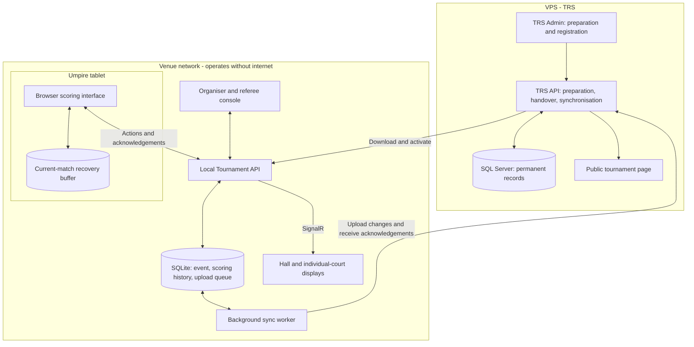

# TRS Tournament Operations Architecture

Date: 2026-10-06  
Status: Proposed architecture and implementation planning reference. Document creation is approved; application, database, deployment changes, and unresolved business rules require separate approval.

## 1. Purpose and objectives

Extend TRS with a venue-local tournament operations application that lets organisers run courts, umpires record scores, and spectators follow live displays.

The principal objectives are:

- Make the normal workflow clear enough for first-time users to operate with minimal guidance.
- Reuse TRS event, registration, participant, and fixture information without entering it again.
- Continue tournament operations, including progression, when the internet or VPS is unavailable after preparation and activation.
- Keep the local server authoritative during venue operation.
- Allow limited tablet storage for the current match and unsynchronised scoring actions as a recovery aid.
- Give TRS a complete permanent tournament record after synchronisation.
- Keep the first release practical: one venue server, browser interfaces, manual assignment with checks, and controlled recovery.

The wider platform may later include court booking using shared venue and court identifiers. Court booking is outside the initial scoring implementation.

## 2. Design inspiration and evidence limits

RallySport provides useful interaction references: a central court console, court-code access on tablets, large scoring controls, match queues, and live hall displays.

- [RallySport public overview](https://www.rallysport.app/)
- [RallySport FMBC 2026 case study](https://www.rallysport.app/stories/fmbc-2026)
- Local reference video: `rally.mp4` in the repository root.

The case study describes importing prepared Tournament Software draws, iPad scoring, court assignment, and hall displays. It also states that RallySport's team operated the console at that event. These observations inform the interface proposal; they do not establish that untrained organisers can operate every function unaided.

RallySport's offline architecture, conflict handling, and device-recovery guarantees have not been verified. The local-server design below is a TRS proposal, not a claim about RallySport's implementation.

## 3. Overall architecture

Two deployments form one connected platform:

1. **TRS on the VPS:** preparation, registration, payments, permanent records, and remote public information.
2. **Tournament Operations at the venue:** courts, assignments, scoring, results, local advancement, and hall displays.

The local API controls tournament operations during venue control. All venue clients communicate through it; they never open database files or write directly to database tables.

The local installation must include all required frontend resources, rules, access checks, and local name resolution. Refreshing a page, authenticating a prepared official, or starting an assigned match must not require the VPS, a CDN, or an internet login provider.

## 4. Responsibilities and ownership

| Area | TRS on VPS | Venue application |
|---|---|---|
| Event setup, registration, payments, refunds | Owns | Receives only necessary tournament data |
| Initial seeding and fixture preparation | Owns before activation | Downloads prepared competition |
| Court and umpire assignments | Displays synchronised state | Owns during venue operation |
| Live scoring and corrections | Stores synchronised records | Validates and records |
| Standings and round advancement | Owns outside venue control | Owns during venue control |
| Public information | Remote tournament page | Local hall and court displays |
| Long-term records | Permanent event record | Operational copy and retained backup |

### 4.1 Event control lifecycle

| State | Writer for tournament operations |
|---|---|
| TRS preparation | TRS |
| Venue operation | The authorised venue server |
| Returned to TRS | TRS; local event becomes read-only |

For the first release, hand over an event as a whole to one venue server. This avoids mixed ownership across programs and supports cross-program scheduling checks.

Downloading an event is preparation, not permission to operate it. Activation must complete while TRS is reachable:

1. Download and validate the event package.
2. Admin requests activation.
3. TRS records the designated server and creates a control session.
4. The venue server receives and acknowledges the grant.
5. An interrupted handshake can be queried and resumed without creating another owner.

All uploads identify the active control session. TRS blocks ordinary roster, draw, score, and advancement changes for the event while venue control is active.

A missing heartbeat or internet outage must **not** automatically return ownership to TRS. Emergency takeover is an explicit recovery procedure that isolates the old server and rejects its stale uploads. A session identifier alone cannot stop an isolated old machine accepting local input; operational isolation is part of recovery.

Initial activation during an internet outage is outside the first release unless a separate offline-authorisation design is approved.

## 5. Person-by-person event flow

### 5.1 Admin prepares the event in TRS

The admin creates programs, manages registrations and payments, reviews entries, sets scoring rules, seeds players, and generates initial fixtures.

He reviews the prepared competition and marks it ready for venue preparation.

### 5.2 Admin downloads the event

The admin opens the local organiser dashboard, chooses **Download event from TRS**, and selects the tournament.

The package contains:

- Stable event, program, fixture, entry, participant, and match identifiers.
- Display names and identities needed for player-clash detection.
- Current fixture structure, seeds, scoring rules, and advancement configuration.
- Court and official information where configured.
- Data version and application/rules compatibility information.

Download the full available competition state and progression configuration, even if later-round match instances will only be created after earlier results.

The local dashboard flags missing or incompatible information. Re-downloading must not overwrite local play or confirmed results.

### 5.3 Admin checks venue readiness and activates

The admin configures available courts and officials, verifies device connectivity, opens a display, and checks that local pages can load without internet dependencies.

He selects **Start venue operation** and completes the control handover.

### 5.4 Admin pairs and distributes tablets

Each tablet joins venue Wi-Fi and opens the local scoring page. A temporary code or QR code pairs it to a court, subject to organiser approval.

The screen displays its court and **Waiting for a match**. Pairing lasts for the session; it is not repeated for every match.

Umpire identity is recorded separately from the tablet and court. A new umpire can take over without rebuilding the device setup.

### 5.5 Organiser queues and calls matches

The organiser sees court cards, available officials, and eligible upcoming matches. He can queue the next match before a court becomes free and call its players.

A queued match is tentative. Player presence, clashes, rest periods, and prerequisites are checked again before assignment and start. Missing players may cause a match to be skipped temporarily; a walkover is an authorised decision, not an automatic consequence of missing check-in.

### 5.6 Organiser assigns a match

The organiser chooses an eligible match, a ready court, and an available umpire. The assignment appears on the tablet and display.

The system checks that the match is eligible, neither player is occupied elsewhere, rest requirements are met, the umpire is available, and the court is ready.

### 5.7 Umpire verifies and starts

The umpire checks the players, program, round, and scoring format, then completes approved starting setup and selects **Start match**.

The server records the start and marks the match, court, and umpire occupied.

### 5.8 Umpire scores

The umpire awards points using large controls. The tablet buffers each action, submits it immediately, and distinguishes pending actions from server-confirmed state.

The local server saves valid actions and updates the organiser console and hall display. Undo is recorded as a correction action, preserving history.

### 5.9 Umpire confirms the result

The umpire reviews the winner and game scores, then selects **Confirm result**. The server accepts confirmation only after receiving the complete action sequence and validating the outcome.

Proposed default: an umpire confirms normal results; a referee handles disputes and exceptional corrections. This business rule requires approval.

If unsynchronised actions remain on the tablet, the result is not yet official at the local server and resources must not be silently released.

### 5.10 Court and official become ready

Separate completion from physical readiness. The umpire indicates **Court ready** and **Available** or **On break**. These choices can appear in the result-completion workflow without a separate complex screen.

The confirmed result starts player-rest calculations from the approved actual-finish-time rule. The organiser assigns the next eligible match once court and official readiness permit it.

### 5.11 Organiser advances the competition

When the selected format's prerequisites are satisfied, the dashboard offers **Generate next round** or the appropriate progression action.

The local server uses shared competition rules, records the new matches with stable identifiers, and queues the change for TRS. TRS does not independently generate a competing round.

Restricting advancement to the VPS would allow the current round to finish during an outage but could stop the tournament between rounds. Local advancement is therefore part of the recommended architecture and remains an explicit approval decision.

### 5.12 Admin closes the event

The admin resolves pending matches and disputes, confirms final placements, checks synchronisation, and selects **Complete event**.

TRS must acknowledge the final change sequence and tournament version before ownership returns. If disconnected, the event can be finished locally while handover remains pending.

Retain the local database and create an event backup. After successful handover the local event is read-only; later corrections follow TRS authorisation rules.

## 6. Local application modules

Use one ASP.NET Core application with these responsibilities, not independent microservices:

| Module | Responsibility |
|---|---|
| Event preparation | Download, validation, activation, local access preparation, closure |
| Tournament operations | Courts, officials, device sessions, queue, readiness, assignments |
| Scoring and results | Points, undo, exceptional outcomes, confirmation, corrections |
| Competition progression | Standings, tie-breaks, readiness checks, next-round generation |
| Synchronisation worker | Ordered uploads, retries, acknowledgements, progress and errors |

## 7. Interface design

| Screen | Primary content |
|---|---|
| Venue preparation | Download, missing items, connection checks, activation |
| Court console | Court cards, live matches, scores, officials, device health, queue, next action |
| Umpire | Verify, start, score, undo, review, confirm, readiness |
| Referee controls | Corrections, disputes, exceptional outcomes, takeover and reassignment |
| Hall overview | Multiple courts, current scores, called matches |
| Single-court display | Large player names, games, points, match state |
| TRS public page | Synchronised scores, draws, results, freshness indicator |

The court console is the organiser's default screen during play. Routine actions remain visible; advanced and recovery actions appear only when relevant.

Displays show server-confirmed information and clearly indicate stale data. Public screens must not expose pairing codes, admin actions, or private participant details.

A clearly separated sample-match practice mode is recommended for usability testing and umpire familiarisation. Practice data must never enter an actual tournament or upload queue.

## 8. Data architecture

### 8.1 Logical local records

| Record | Purpose |
|---|---|
| Event package | Prepared competition, entries, rules, versions |
| Venue control session | Authorised server and event ownership |
| Courts and officials | Availability, breaks, readiness |
| Device sessions | Pairing, court, active scoring authority, revocation |
| Matches and assignments | Match state, revision, court, umpire, timings |
| Scoring actions | Ordered points, undo, corrections, confirmations |
| Player availability | Derived active-match and rest eligibility across programs |
| Pending synchronisation | Changes awaiting acknowledgement by TRS |

Existing TRS IDs are retained. Locally created matches and actions need globally unique identifiers and a defined mapping to existing fixture identities.

Keep point history and operational assignments separate from the fixture bracket document. The bracket can remain represented by fixture JSON while per-point changes use dedicated records.

Match, assignment, and official states are displayed as readable labels but stored and exchanged using central short codes, following existing TRS policy. Exact codes require a schema proposal.

### 8.2 Match and resource states

Proposed normal match flow:

`Queued -> Called -> Assigned -> Playing -> Awaiting confirmation -> Completed`

Explicit exception handling is required for suspension, walkover, retirement, cancellation, and disputed results. These outcomes must not be represented by invented point histories.

Proposed court flow:

`Available -> Assigned -> In use -> Awaiting readiness -> Available`

Courts can separately be marked unavailable.

Proposed official flow:

`Available -> Assigned -> Officiating -> Available / On break`

### 8.3 Identity and privacy

Player-clash detection across singles, doubles, and other programs requires stable player identity. Matching by name alone is insufficient. Ambiguous identity mappings must be resolved during preparation.

Transfer only information required to operate the event. Payment secrets, unrelated contact information, and registration documents are not part of the normal venue package.

## 9. Scoring protocol and tablet recovery

For each point or permitted scoring action:

1. Generate an action ID and per-session sequence number.
2. Persist the action in the active-match buffer.
3. Submit it with device-session authority and the expected match revision.
4. Server verifies authority, sequence, duplicate status, and rules.
5. Server commits the action, match state, and pending cloud update together.
6. Server acknowledges and broadcasts the committed revision.

The tablet may immediately display a provisional score, with a visible pending indicator. Hall and public displays use server-confirmed state.

A lost acknowledgement must not count a retry twice. Clients reconnect by retrieving the latest state and reconciling action acknowledgements. SignalR notifications are not the permanent scoring record.

Offline buffering applies only to the already-loaded active match. A disconnected tablet cannot accept new assignments, advance rounds, or officially free resources.

Service/end tracking, if included, is part of the match state and undo behaviour. Changing screen sides must never change which entry owns a point.

Browser buffering is a recovery aid, not a guaranteed backup. Check storage availability, avoid private browsing, and define safe cleanup only after required server acknowledgement. The precise retention period remains to be approved.

## 10. Tablet replacement

The organiser uses **Replace scoring device**:

1. Pause the match and confirm the umpire has stopped using the old device.
2. Revoke the old device's scoring session.
3. Pair a replacement using fresh temporary authorisation.
4. Retrieve server-confirmed players, points, games, and approved service/end state.
5. Umpire/referee verifies the restored state.
6. Reconcile missing actions through an audited correction if necessary.
7. Resume under the new scoring session.

The court, entries, and officials remain assigned during replacement. Displays show the paused state.

If the old tablet reconnects, it cannot silently apply pending actions. Preserve them for review where recoverable. Points stored only on an inaccessible damaged tablet cannot be recovered automatically.

## 11. Shared competition rules

The existing `Backend/TRS_API/Services/FixtureGenerationService.cs` combines competition behaviour with persistence, including SQL Server-specific row locking. It cannot simply be copied unchanged to a SQLite venue host.

Extract reusable, persistence-independent rules into a shared library for:

- Score and outcome validation.
- Standings and approved tie-breaks.
- Advancement eligibility.
- Next-round generation.

Database transactions, locks, API authorisation, and auditing remain in the relevant host. Preserve existing TRS behaviour through regression checks before enabling local operation.

Pin compatible application/rules versions for an active event. No unattended rule or application upgrades during play.

## 12. TRS synchronisation

Use application-level synchronisation, not bidirectional database replication or whole-database copying.

### 12.1 Upload operation

Proposed initial interval: every two seconds while pending changes exist, subject to load testing.

Every accepted local mutation creates a durable pending-upload record in the same transaction. Upload batches contain event identity, control session, unique operation IDs, ordered sequence, and schema/rules version.

TRS:

1. Validates ownership and compatibility.
2. Detects duplicates and sequence gaps.
3. Validates and applies the batch transactionally.
4. Updates its stored match history and tournament projection.
5. Acknowledges the last safely committed sequence.

The venue server retains and retries unacknowledged operations. A malformed or conflicting operation is surfaced for intervention, not silently skipped.

### 12.2 Records uploaded

- Point history, undo, and referee corrections.
- Current game scores and confirmed results.
- Outcome type, winner, court, official, and actual timings.
- Queue/assignment changes needed for public operational views.
- Standings and fixture progression, including generated match IDs.
- Relevant actor/audit information and revisions.

The exact payloads and retention policy require API design approval. Existing public contracts should remain compatible through additive endpoints and explicit projections.

### 12.3 User-visible health

Distinguish:

- Tablet to local server connection.
- Local server to VPS connection.
- Rejected synchronisation requiring intervention.

Example: **Venue running normally - TRS disconnected - 24 updates waiting**.

A VPS outage may make the remote site unavailable; an internet-only venue outage leaves remote users viewing stale data. Neither prevents local operations.

## 13. Security and operational boundaries

- Use trusted HTTPS for local clients and VPS communication.
- Configure local name resolution and certificates before the event; do not depend on internet access at match time.
- Pairing codes are temporary and establish restricted sessions, not permanent shared admin credentials.
- Restrict scoring sessions to the intended match/court and support revocation and explicit takeover.
- Prepare scoped local organiser/referee access; do not replicate general TRS passwords to the venue database.
- Keep the scoring network separate from public spectator access where practical.
- Use existing TRS audit conventions for cloud admin actions and equivalent attributable local logs for venue mutations.
- Synchronisation credentials must be scoped to the venue server and authorised event operations.
- Expiry, renewal, and revocation behaviour during an extended offline event require explicit design so legitimate local operation does not unexpectedly stop.

## 14. Deployment proposal

| Area | Proposed technology |
|---|---|
| Browser interfaces | React, reusing suitable TRS components |
| Venue API and workers | ASP.NET Core |
| Competition rules | Shared C# library |
| Local database | SQLite on the venue computer, backend-only access |
| VPS database | Existing SQL Server |
| Live local updates | SignalR |
| Tablet recovery | IndexedDB with an explicitly cached scoring interface |
| Venue process | Windows service with automatic startup |

Database suitability, runtime versions, and supported tablet/browser versions must be validated against the expected court count before implementation is finalised.

### 14.1 Equipment

- Dedicated venue computer connected by Ethernet.
- Controlled router/access points with coverage tested at every court.
- Charged tablets and at least one prepared spare.
- Display computer and projector/TV, preferably wired to the venue network.
- Backup power for the server and network equipment.
- Separate backup destination and a prepared spare server computer.

The installer should bundle application resources. Local routing, authentication, and page refresh must work with the venue internet physically disconnected.

### 14.2 Failure handling

| Failure | Expected behaviour |
|---|---|
| VPS or internet unavailable | Local scoring, assignment, display, and advancement continue; uploads queue |
| Tablet loses Wi-Fi | Buffer the active match; hall remains at last confirmed score with delayed indicator |
| Tablet fails | Controlled replacement and score reconciliation |
| Venue network fails | Tablets may buffer active matches; central assignments and shared displays cannot update |
| Local service restarts | Recover persisted matches, sessions, assignments, and upload queue; clients reconnect |
| Local disk/computer fails | Restore a consistent backup to spare hardware and reconcile newer actions |
| Old server returns after replacement | Isolate it; stale control uploads cannot overwrite the recovered event |
| Incorrect confirmed result | Referee correction; protect downstream matches from invalidation |

Take database-consistent backups to a separate device. A second file on the same disk is not protection against disk failure. Restoring an older backup can lose acknowledged local changes; recovery must compare available tablet history and VPS acknowledgements before resuming.

Automatic server failover is outside the first release. Agree recovery-time and possible data-loss tolerances and retain paper scoring as an exceptional fallback.

## 15. Repository and database impact

This section identifies expected scope, not authorisation to modify it. Exact implementation files, scripts, endpoints, and rollback steps must be proposed per delivery stage.

### 15.1 Proposed new areas

- `Backend/TRS_Competition/`: shared competition rules and typed contracts.
- `Backend/TRS_Venue/`: local API, persistence, authentication, live updates, and synchronisation worker.
- `VenueFrontend/`: organiser/referee, scoring, preparation, and display interfaces.
- Additive TRS API synchronisation/preparation modules and their tests.

These are proposed paths and may be refined before approval.

### 15.2 Existing areas likely affected

| Path | Expected change |
|---|---|
| `Backend/TRS_API/Services/FixtureGenerationService.cs` | Separate reusable rules from persistence while preserving behaviour |
| `Backend/TRS_API/Controllers/FixturesController.cs` | Enforce venue ownership and integrate approved transitions |
| `Backend/TRS_Data/Models/Fixture.cs` | Necessary fixture version/control representation |
| `Backend/TRS_Data/Models/TRSDbContext.cs` | New control/history/synchronisation mappings |
| `Backend/TRS_API/Services/StatusCodes.cs` | Central short operational codes |
| `Frontend/src/pages/admin/Fixtures.tsx` | Preparation, ownership, and sync visibility |
| `Backend/TRS_FixtureTests/Program.cs` | Preserve competition behaviour and test extracted rules |
| Architecture, business rules, API map, runbook | Align documented behaviour and recovery procedures |

All fixture-related mutation paths, including participant changes and event/program operations, need an ownership audit. The final implementation scope may therefore include additional directly related files, subject to approval.

### 15.3 Database and API impact

- Keep the existing TRS SQL Server database and payment/registration ownership.
- Add cloud records for venue-control sessions, synchronisation receipts, revisions, and detailed match history.
- Create a separate local event database for venue operation.
- Add scoped preparation, handover, and synchronisation endpoints.
- Preserve existing public contracts where possible; public scoreboards use approved data projections.
- No destructive table or column changes are proposed in this document.

### 15.4 Rollback principles

Before venue activation, disable the feature and retain existing TRS operation. Preserve additive data until its retention is reviewed.

After local play begins, first reconcile and recover event records. Reverting software or unlocking cloud edits without reconciliation risks losing results or creating competing records. Structural schema changes require their own reviewed rollback plan.

## 16. Business decisions requiring approval

| Decision | Recommended direction / unresolved detail |
|---|---|
| Next-round generation | Local during venue control, using shared TRS rules |
| Event ownership | Whole event on one local server for first release |
| Result authority | Umpire confirms normal results; referee handles exceptions |
| Court readiness | Explicit readiness separate from result completion |
| Official availability | Available or on break after completion |
| Supported competition formats | Select first-release badminton formats; do not assume all existing formats use point scoring |
| Scoring configurations | Approve game length, win conditions, and special event variations |
| Service/end tracking | Decide initial scope, especially doubles server/receiver behaviour |
| Rest periods | Approve duration, finish-time basis, and override permissions |
| No-show, retirement, suspension | Agree outcomes and effects on progression and resource release |
| Corrections after dependent play | Block routine edits; define referee resolution procedure |
| Player identity | Define cross-program identity matching and ambiguity resolution |
| Offline duration and permissions | Define event-bound local authorisation and recovery policy |
| Recovery buffers and audit retention | Agree cleanup periods and access |
| Server recovery | Agree acceptable downtime and possible manual reconciliation window |
| Future booking integration | Shared court IDs; booking reservation workflow is a later scope |

## 17. Delivery plan

### Stage 1 - Rules and contracts

Agree the decisions above, define ownership/synchronisation contracts, and isolate shared competition rules with regression verification.

### Stage 2 - One-court pilot

Local match preparation, pairing, point scoring, undo, result confirmation, court readiness, hall display, and tablet recovery/replacement.

### Stage 3 - Multi-court tournament operations

Court console, tentative queue, official availability, player-clash/rest checks, referee exceptions, and local advancement.

### Stage 4 - TRS integration

Event download, activation, reliable uploads, public results projection, closure, and acknowledged return of ownership.

### Stage 5 - Venue rehearsal and release

Test real tablets and the intended court count, record usability issues, simulate failures, verify backups, and release only after acceptance criteria pass.

Defer automatic court assignment, automatic server failover, messaging integrations, streaming, additional competition formats, and court-booking workflows unless separately prioritised.

## 18. Acceptance and verification

### Happy path

- Prepare in TRS, download, activate, pair tablets, assign matches, score, confirm, release resources, and play the next round.
- Verify hall displays, remote projections, full match history, and final control handover.
- Confirm typical umpire actions are understandable to a first-time user.

### Validation cases

- Reject unauthorised or revoked devices and stale control sessions.
- Prevent duplicate scoring actions, illegal outcomes, missing action sequences, and conflicting match updates.
- Prevent player/official clashes and assignments violating approved rest rules.
- Reject incompatible/incomplete downloads and cloud edits while venue ownership applies.
- Block unsafe result corrections after dependent play.

### Edge cases and recovery

- Lost score acknowledgement followed by retry.
- Wi-Fi interruption, tablet refresh, browser restart, storage failure, and replacement with unsent actions.
- VPS outage, rejected upload, out-of-order batch, and reconnect after a long backlog.
- Local service restart, full computer restart, restored older backup, and old server reconnecting.
- BYEs, walkover, retirement, suspension, absent players, official breaks, and unavailable courts.
- Singles/doubles service and end changes, including undo, if included in scope.
- Same player across programs, ambiguous identities, delayed result confirmation, and rest-period calculation.

### Main end-to-end acceptance scenario

> Prepare and activate an event. Disconnect venue internet before opening the scoring interfaces. Run multiple courts, replace a tablet, confirm results, generate and play the next round, and restart the local service. Reconnect to TRS and verify all accepted records arrive without duplicate actions, missing confirmed results, or competing fixtures. Complete the event and return control to TRS.

This demonstrates VPS independence; it does not promise uninterrupted shared operation during a venue-network, power, or local-server failure.

### Implementation checks

Run focused backend, frontend, shared-rule, and synchronisation verification appropriate to each approved change. Follow the repository rule to check for a running API before builds and never stop it without permission.

No implementation tests are required for creating this planning document. Verify Markdown structure and consistency with the agreed discussion.

## 19. Supporting technical references

- [ASP.NET Core Windows service hosting](https://learn.microsoft.com/en-us/aspnet/core/host-and-deploy/windows-service)
- [SQLite deployment suitability](https://www.sqlite.org/whentouse.html)
- [SignalR JavaScript client](https://learn.microsoft.com/en-us/aspnet/core/signalr/javascript-client)
- [Service workers and secure origins](https://developer.mozilla.org/en-US/docs/Web/API/Service_Worker_API/Using_Service_Workers)
- [Browser storage quotas and eviction](https://developer.mozilla.org/en-US/docs/Web/API/Storage_API/Storage_quotas_and_eviction_criteria)

These references support technology choices. Actual TRS behaviour remains defined by approved business rules, implementation, and verification.
